<h1 align="center">Hi 👋, I'm NoMatch</h1>
<h3 align="center">A passionate C++ Developer</h3>

- 🔭 I’m currently working on **Growing**
- 🌱 I’m currently learning **C++\Pyhon\SCM\DATABASE\Algorithm\Computer networks**
- 💬 Ask me about **Math**
- 📫 How to reach me: **3117891749@qq.com**
- ⚡ Fun fact: **Running**

- <h3 align="left">Languages and Tools:</h3>

  
  
  

  

